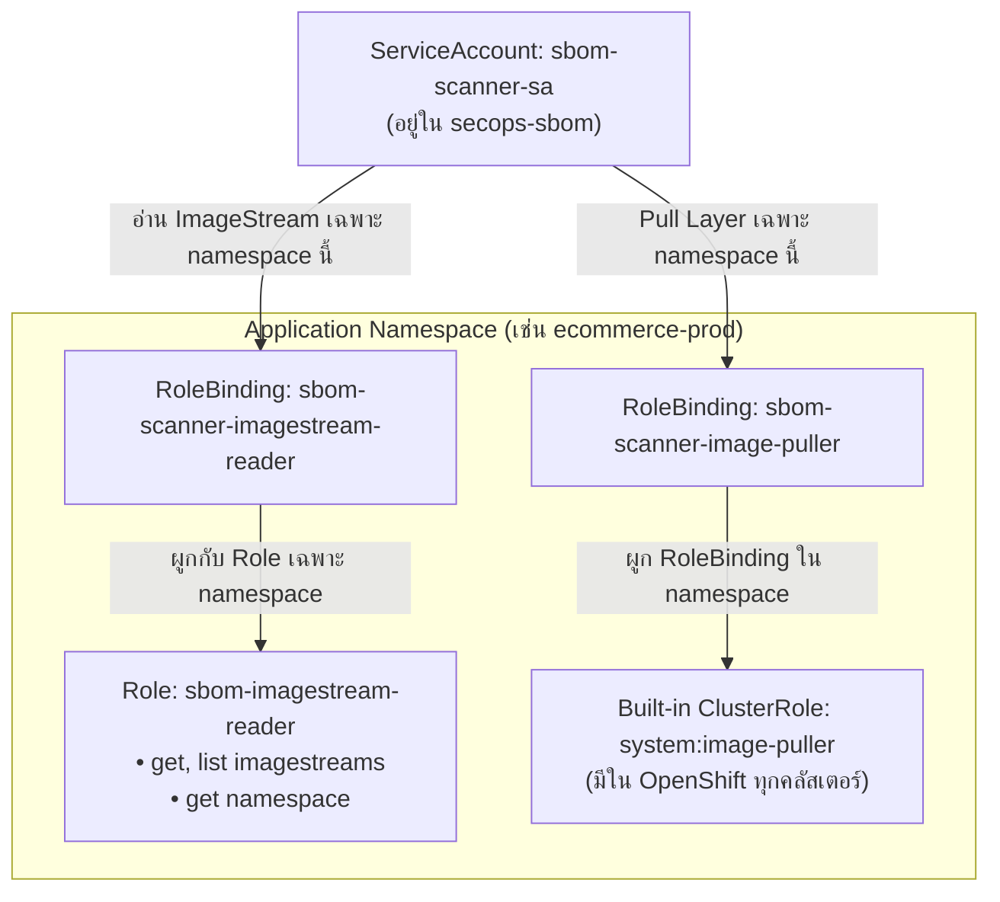

# OpenShift Deployment & Operations Guide (Phase 2 & Phase 3)

เอกสารคู่มือสถาปัตยกรรม ขั้นตอนการติดตั้ง การบริหารสิทธิ์ (RBAC) และการใช้งานระบบบริหารจัดการ SBOM & Vulnerability บน **Red Hat OpenShift** โดยแยกเป็นอิสระจากสภาพแวดล้อม Phase 1 (Local Docker PoC) เพื่อความชัดเจนและง่ายต่อการปฏิบัติงานจริง

---

## 1. ภาพรวมสถาปัตยกรรมระดับ Production บน OpenShift

ระบบถูกออกแบบให้ทำงานภายใต้มาตรฐานความปลอดภัยระดับสูงสุดของ Red Hat OpenShift (**Restricted Pod Security Admission / Restricted-v2 SCC**) และใช้แนวคิด **Container Image-Centric Approach** ดึง Image จาก OpenShift Internal Registry มาสแกนเลเยอร์แบบ Static (Zero Code Execution)

```mermaid
flowchart TD
    subgraph OCP_Cluster["Red Hat OpenShift Cluster"]
        direction TB

        subgraph Ingress_Layer["Ingress & Routing Layer"]
            Router["OpenShift Ingress Router<br>(TLS Edge Termination)"]
        end

        subgraph SecOps_Namespace["Namespace: secops-sbom (Restricted PSA)"]
            direction TB
            Route["Route: dependency-track<br>(HTTPS Port 443)"]
            
            Frontend["Deployment: dtrack-frontend<br>• Nginx Non-root (Port 8080)<br>• Single-Route Reverse Proxy /api"]
            
            APIServer["Deployment: dtrack-apiserver<br>• Java 21 / D-Track 4.11.7<br>• Parallel GC (MaxRAM 75%)<br>• Corporate Proxy Support"]
            
            DB["Deployment: postgres<br>• Hardened PostgreSQL 15<br>• OpenShift GID 0 Compliant"]
            
            PVC_API[("PVC: dtrack-data-pvc<br>(50 GiB - Lucene Index)")]
            PVC_DB[("PVC: postgres-data-pvc<br>(100 GiB - Storage)")]
            
            SecretKey["Secret: dtrack-automation-key<br>(API Key สำหรับ Automation)"]
            
            ScannerPod["Ephemeral Job Pod: trivy-scanner<br>• trivy (CycloneDX v1.6)<br>• oc CLI (In-Cluster)<br>• ServiceAccount: sbom-scanner-sa"]
        end

        subgraph Target_Namespace1["Application Namespace: ecommerce-prod"]
            IS1["ImageStream: payment-service<br>Tags: v1.0.0, v1.1.0"]
            REG1["OpenShift Internal Registry<br>(image-registry...svc:5000)"]
            ScannerPod["Ephemeral Job Pod: trivy-scanner<br>• trivy (CycloneDX v1.6)<br>• oc CLI (In-Cluster)<br>• ServiceAccount: sbom-scanner-sa"]
        end

        subgraph Target_Namespace1["Application Namespace: ecommerce-prod"]
            IS1["ImageStream: payment-service<br>Tags: v1.0.0, v1.1.0"]
            REG1["OpenShift Internal Registry<br>(image-registry...svc:5000)"]
            RB1["RoleBinding:<br>• system:image-puller<br>• sbom-imagestream-reader"]
        end

        subgraph Target_Namespace2["Application Namespace: core-banking"]
            IS2["ImageStream: auth-service<br>Tags: v2.0.0"]
            REG2["OpenShift Internal Registry<br>(image-registry...svc:5000)"]
            RB2["RoleBinding:<br>• system:image-puller<br>• sbom-imagestream-reader"]
        end

        Router --> Route
        Route --> Frontend
        Frontend -->|"/api (Internal Proxy)"| APIServer
        APIServer --> DB
        APIServer --- PVC_API
        DB --- PVC_DB

        ScannerPod -->|1. oc get is (ดึง Create Date)| IS1
        ScannerPod -->|2. Pull Layer ผ่าน SA Token| REG1
        ScannerPod -->|3. POST /api/v1/bom & Reconcile| APIServer
        ScannerPod -.-> SecretKey
    end
```

---

## 2. โครงสร้าง In-House Container Images (`images/openshift/`)

ไฟล์ Dockerfile และ Assets ทั้งหมดสำหรับ OpenShift ถูกจัดเก็บแยกเป็นอิสระไว้ที่ [`images/openshift/`](file:///c:/KK/Workspace/SBOM-image-scan/images/openshift):

| โฟลเดอร์ Image | ฐานระบบ (Base) | คุณสมบัติเฉพาะทางสำหรับ OpenShift | สิทธิ์การใช้งาน (License) & Roadmap |
| :--- | :--- | :--- | :--- |
| **`postgres/`** | `quay.io/sclorg/postgresql-15-c9s` (หรือ `registry.redhat.io/rhel9/postgresql-15`) | • ออกแบบสำหรับ OpenShift Arbitrary UID / Group 0 โดยเฉพาะ มี `nss_wrapper` ในตัว<br>• มี Container Health Check ในตัว (`/usr/libexec/check-container`)<br>• รองรับไฟล์ปรับแต่งผ่าน `/opt/app-root/src/postgresql-cfg/*.conf` และ init SQL ผ่าน `postgresql-init/` | **ฟรี 100% (Open Source - Apache 2.0 / BSD)**<br>• ดูแลโดยทีม Red Hat Software Collections (SCLorg)<br>• รองรับ PG15 ถึงปลายปี 2027<br>• หากมี OpenShift Subscription สามารถสลับไปใช้ `registry.redhat.io/rhel9/postgresql-15` ได้ทันที |
| **`dtrack-apiserver/`** | `dependencytrack/apiserver:4.11.7` | • ปรับแต่งสิทธิ์ GID 0 สำหรับโฟลเดอร์ `/data` และ `/tmp`<br>• ตั้งค่า `ALPINE_DATA_DIRECTORY=/data` รองรับ Arbitrary Non-root UID<br>• ใช้ Parallel GC ของ Base Image หลีกเลี่ยง GC Flag Conflict<br>• เพิ่ม `startupProbe` สูงสุด 10 นาทีเพื่อรองรับ DB Migration รอบแรกอย่างปลอดภัย | **ฟรี 100% (Apache 2.0)**<br>• OWASP Dependency-Track Official Image<br>• โปรเจกต์หลักระดับ Flagship ของ OWASP |
| **`dtrack-frontend/`** | `dependencytrack/frontend:4.11.7` | • รันด้วย Non-root UID `10001` และรองรับ `readOnlyRootFilesystem: true`<br>• `nginx.conf` ใช้ **Lazy DNS Resolver** ป้องกัน Nginx Crash Loop หาก API Server ยังไม่พร้อม<br>• Reverse Proxy `/api/` ภายในคลัสเตอร์ ทำให้ใช้ **Single-Route Architecture** ได้โดยไม่ติด CORS | **ฟรี 100% (Apache 2.0)**<br>• OWASP Dependency-Track Official Image |
| **`trivy-scanner/`** | `registry.access.redhat.com/ubi9/ubi-minimal` | • คัดลอกไบนารี `trivy:0.59.1` และ `oc` CLI จาก `origin-cli:4.14` รันบน glibc Native อย่างปลอดภัย<br>• มี Build-time Smoke Test ตรวจสอบความเข้ากันได้ของไบนารีทั้งหมดตั้งแต่ขั้นตอน Build<br>• Entrypoint [`scan-openshift.sh`](file:///c:/KK/Workspace/SBOM-image-scan/images/openshift/trivy-scanner/scan-openshift.sh) รองรับ Service CA Bundle, In-Cluster Token, และ Reconcile ข้าม Namespace อย่างแม่นยำ | **ฟรี 100% (Red Hat UBI EULA)**<br>• ไม่ต้องมี Red Hat Subscription ไม่เสียค่าใช้จ่าย<br>• ใช้งานและแจกจ่ายต่อได้ทั้งเชิงพาณิชย์และทั่วไป<br>• **Enterprise Lifecycle ถึงปี 2032 (RHEL 9)** ได้รับการแพตช์ CVE อย่างต่อเนื่อง |

---

## 3. ขั้นตอนการติดตั้ง Core Infrastructure (Phase 2 Deployment)

คำสั่งทั้งหมดสั่งการผ่าน `oc` CLI โดยต้องล็อกอินเข้าคลัสเตอร์ OpenShift เรียบร้อยแล้ว:

### ขั้นตอนที่ 1: สร้าง Namespace ประจำระบบ SecOps
```bash
oc apply -f phase2-openshift-core/namespace.yaml
```
* Namespace `secops-sbom` จะถูกบังคับใช้ฉลาก `pod-security.kubernetes.io/enforce: restricted`

### ขั้นตอนที่ 2: สร้าง ImageStreams และ BuildConfigs
```bash
oc apply -f phase2-openshift-core/imagestreams/imagestreams.yaml
oc apply -f phase2-openshift-core/buildconfigs/buildconfigs.yaml
```

### ขั้นตอนที่ 3: สั่งบิลด์ In-House Images ทั้ง 4 ตัว
สามารถสั่งบิลด์ผ่าน Git Repo หรือสั่ง Binary Build ตรงจากโฟลเดอร์ในเครื่อง:
```bash
# บิลด์ตรงจากโฟลเดอร์ images/openshift/
oc start-build bc-postgres-dtrack   --from-dir=images/openshift/postgres   -n secops-sbom --wait
oc start-build bc-dtrack-apiserver --from-dir=images/openshift/dtrack-apiserver -n secops-sbom --wait
oc start-build bc-dtrack-frontend  --from-dir=images/openshift/dtrack-frontend  -n secops-sbom --wait
oc start-build bc-trivy-scanner    --from-dir=images/openshift/trivy-scanner    -n secops-sbom --wait
```

### ขั้นตอนที่ 4: ติดตั้งฐานข้อมูล PostgreSQL
```bash
oc apply -f phase2-openshift-core/postgres/postgres-all.yaml
```
* สร้าง PVC 100 GiB, Secret รหัสผ่าน, Deployment และ Service (Port 5432)
* ตรวจสอบความพร้อม: `oc rollout status deployment/postgres -n secops-sbom`

### ขั้นตอนที่ 5: ตั้งค่า Corporate Proxy และ Deploy Dependency-Track Core
```bash
# ปรับแต่ง Proxy ใน configmap-proxy.yaml หากคลัสเตอร์ต้องออกเน็ตผ่าน Forward Proxy
oc apply -f phase2-openshift-core/configmap-proxy.yaml

# ติดตั้ง API Server (PVC 50 GiB)
oc apply -f phase2-openshift-core/dtrack-api-all.yaml
oc rollout status deployment/dtrack-apiserver -n secops-sbom

# ติดตั้ง Web Frontend & OpenShift Route
oc apply -f phase2-openshift-core/dtrack-frontend-all.yaml
oc rollout status deployment/dtrack-frontend -n secops-sbom

# บังคับใช้นโยบายความปลอดภัย Zero-Trust NetworkPolicy
oc apply -f phase2-openshift-core/network-policy.yaml
```

### ขั้นตอนที่ 6: การเข้าใช้งานครั้งแรกและการออก Automation API Key
1. ตรวจสอบ URL ของ Web Dashboard:
   ```bash
   oc get route dependency-track -n secops-sbom -o jsonpath='{"https://"}{.spec.host}{"\n"}'
   ```
2. เปิด URL บนเบราว์เซอร์ ล็อกอินด้วย `admin` / `admin` และตั้งรหัสผ่านใหม่ที่ปลอดภัย (เช่น `Admin12345!`)
3. ไปที่เมนู **Administration -> Access Management -> Teams**:
   * กด **Create Team** ตั้งชื่อทีมว่า `Automation`
   * มอบสิทธิ์ (Permissions) 6 รายการ:
     * `BOM_UPLOAD`
     * `PROJECT_CREATION_UPLOAD`
     * `PORTFOLIO_MANAGEMENT`
     * `VIEW_PORTFOLIO`
     * `VIEW_VULNERABILITY`
     * `VULNERABILITY_ANALYSIS`
   * กด **Regenerate / Create API Key** แล้วคัดลอกคีย์มาบันทึกเป็น Secret:
     ```bash
     oc create secret generic dtrack-automation-key \
       --from-literal=API_KEY="<PASTE_YOUR_COPIED_API_KEY>" \
       -n secops-sbom
     ```

---

## 4. การบริหารสิทธิ์แบบ Scoped RBAC (Option 1 - Zero ClusterRole)

> [!IMPORTANT]
> **ระบบนี้ไม่จำเป็นต้องใช้สิทธิ์ Cluster Admin และไม่สร้าง ClusterRole ใดๆ ทั้งสิ้น**
> สิทธิ์ทั้งหมดถูกจำกัดขอบเขตในระดับ **Project (Namespace-scoped)** 100% ผู้ดูแลของแต่ละ Namespace แอปพลิเคชัน (Project Admin) สามารถอนุมัติหรือยกเลิกการเข้าถึงได้ด้วยตนเองอย่างอิสระ

### โครงสร้าง RBAC ภายใน Namespace แอปพลิเคชัน:


### สิทธิ์ที่ใช้ใน [`onboard-namespace-rbac.yaml`](../phase3-ephemeral-worker/rbac/onboard-namespace-rbac.yaml):
1. **`sbom-imagestream-reader` (Namespaced `Role`):**
   * เป็น **`Role` ระดับโปรเจกต์ (ไม่ใช่ ClusterRole)** สร้างขึ้นใน Application Namespace นั้นๆ เท่านั้น
   * ให้สิทธิ์เฉพาะการอ่าน Metadata ของ ImageStream และดู Namespace ตัวเอง เพื่อค้นหาประวัติและวันเวลาสร้างอิมเมจ
   * **ปลอดภัยขั้นสูงสุด:** ไม่อนุญาตให้อ่าน Pods, Secrets, ConfigMaps, หรือ Events ใดๆ ของแอปพลิเคชัน
2. **`system:image-puller` (Built-in OpenShift ClusterRole ผูกด้วย `RoleBinding`):**
   * ใช้ **`kind: RoleBinding`** (ไม่ใช่ `ClusterRoleBinding`)
   * **ผลลัพธ์:** สิทธิ์ในการดึง Layer อิมเมจจึงถูก **Scoped กักบริเวณให้อยู่เฉพาะภายใน Namespace นั้นเท่านั้น** สแกนเนอร์ไม่สามารถดึงอิมเมจของ Namespace อื่นที่ยังไม่ได้ onboard ได้

### วิธีการ Onboard Namespace แอปพลิเคชันใหม่:
เมื่อมี Namespace แอปพลิเคชันต้องการเข้าร่วมระบบ SBOM (เช่น `ecommerce-prod`):

```bash
# ใช้สิทธิ์ Project Admin ของ Namespace นั้นๆ สั่ง Apply
oc apply -f phase3-ephemeral-worker/rbac/onboard-namespace-rbac.yaml -n ecommerce-prod
```

* **การแยกแยะความปลอดภัย:** หาก Namespace ใดไม่ได้รันคำสั่งนี้ ตัว Scanner Pod จะไม่มีสิทธิ์เข้าถึงหรือมองเห็น Image ใดๆ ของ Namespace นั้นเลย 100%
* **การ Offboard:** เมื่อไม่ต้องการให้สแกนอีกต่อไป ให้สั่ง `oc delete -f phase3-ephemeral-worker/rbac/onboard-namespace-rbac.yaml -n ecommerce-prod` สิทธิ์จะถูกถอนออกทันทีโดยไม่กระทบระบบอื่น

---

## 5. การสั่งสแกน Ephemeral Worker Job (Phase 3 Execution Modes)

สคริปต์ [`images/openshift/trivy-scanner/scan-openshift.sh`](file:///c:/KK/Workspace/SBOM-image-scan/images/openshift/trivy-scanner/scan-openshift.sh) ที่รันภายใน Pod รองรับ **2 โหมดการทำงาน**:

### โหมดที่ 1: CI/CD Pipeline Targeted Mode (ระบุ Image)

เหมาะสำหรับใส่ไว้ใน Pipeline ของแอปพลิเคชัน (GitLab CI, Tekton, Jenkins, GitHub Actions) เพื่อให้สแกนทันทีที่ Build Image เสร็จ

#### ตัวอย่างการเรียกใช้ผ่าน CLI / Script Helper:
```bash
./phase3-ephemeral-worker/test-job-run.sh \
  image-registry.openshift-image-registry.svc:5000/ecommerce-prod/payment-service:v1.2.0 \
  main
```

#### ตัวอย่าง Step ใน CI/CD Pipeline (เช่น GitLab CI / Shell):
```bash
TARGET_IMAGE="image-registry.openshift-image-registry.svc:5000/${CI_PROJECT_PATH}:${CI_COMMIT_TAG}"
JOB_ID=$(date +%s)
JOB_NAME="sbom-scan-${CI_PROJECT_NAME}-${JOB_ID}"

# 1. สร้าง Ephemeral Scan Job ใน Namespace secops-sbom
oc process -f phase3-ephemeral-worker/job-template.yaml \
  -p JOB_NAME="$JOB_NAME" \
  -p TARGET_IMAGE="$TARGET_IMAGE" \
  -p PARENT_VERSION="main" \
  | oc create -n secops-sbom -f -

# 2. รอ Pod เริ่มทำงานและสตรีม Logs ออกมาดูสด
oc wait --for=condition=Ready pod -l app.kubernetes.io/name=sbom-scanner,job-name="$JOB_NAME" -n secops-sbom --timeout=60s || true
oc logs -f "job/$JOB_NAME" -n secops-sbom

# 3. ยืนยันผลลัพธ์
oc wait --for=condition=complete "job/$JOB_NAME" -n secops-sbom --timeout=120s
```

* **กระบวนการภายใน Pod:**
  1. Pod เริ่มต้นขึ้นมา จะใช้คำสั่ง `oc get is` ดึง Creation Date จาก ImageStream ใน `ecommerce-prod`
  2. Trivy สกัด CycloneDX SBOM ผ่าน Internal Registry
  3. ส่งเข้า Dependency-Track API Server และ Reconcile Version `v1.2.0` เป็น `active: true` และปรับเวอร์ชันก่อนหน้าเป็น `inactive`
  4. Job สิ้นสุดการทำงานอย่างสมบูรณ์ภายใน 30–60 วินาที

---

### โหมดที่ 2: Scoped Auto-Discovery Mode (ระบุ `ALL`)

เหมาะสำหรับการทำ **Scheduled Audit (CronJob ประจำสัปดาห์)** หรือการกวาดตรวจสภาพความปลอดภัยของทั้งองค์กร โดยไม่ต้องพิมพ์ชื่อ Image:

```bash
# สั่งสแกนทุก ImageStream ในทุก Namespace ที่ได้รับอนุญาต
./phase3-ephemeral-worker/test-job-run.sh ALL
```

* **กระบวนการภายใน Pod:**
  1. Pod จะใช้คำสั่ง `oc get projects` ตรวจดูรายชื่อ Namespace ทั้งหมดที่ตัวมันได้รับสิทธิ์ (ข้าม namespace ระบบ)
  2. วนลูปอ่าน ImageStream ทั้งหมดใน Namespace เหล่านั้นผ่าน `oc get is -n <ns>`
  3. ดึง Creation Date และสแกน CycloneDX SBOM ส่งเข้า Dependency-Track ครบทุกตัว
  4. สรุปยอดจำนวน Image ที่สแกนสำเร็จทั้งหมดเมื่อจบ Job

---

## 6. การส่งออกรายงานระดับองค์กร (Enterprise Reporting)

สามารถรันสคริปต์รายงานระดับองค์กรจากภายในคลัสเตอร์ หรือจากเครื่องที่เข้าถึง Route ของ Dependency-Track:

```bash
# 1. รายงาน Total Inventory SBOM ระดับองค์กร
python scripts/export-total-sbom.py

# 2. รายงานช่องโหว่ความปลอดภัย (Active Version เท่านั้น)
python scripts/export-vulnerability-report.py --active-only

# 3. รายงานช่องโหว่ความปลอดภัยทั้งหมด (รวม Historical Inactive)
python scripts/export-vulnerability-report.py
```

ไฟล์รายงานจะถูกสร้างขึ้นในโฟลเดอร์ `reports/`:
* `vulnerabilities-detail.csv`: รายการ Finding แยกตาม Project × Component × CVE
* `vulnerabilities-unique.csv`: สรุป Unique CVEs และผลกระทบต่อ Microservices
* `vulnerabilities-summary.csv`: สรุปความรุนแรงตามระดับ Critical, High, Medium, Low
* `total-components-detail.csv`: บัญชีรายการ Software Components ทั้งหมดในองค์กร

---

## 7. ตารางการตรวจสอบและเกณฑ์การยอมรับบน OpenShift (Test Matrix)

| Test ID | หัวข้อการทดสอบ | สิ่งที่ตรวจสอบ | ผลลัพธ์ที่คาดหวัง |
| :--- | :--- | :--- | :--- |
| **TC-OCP-01** | Pod Security Admission | `namespace.yaml` | ติดตั้งบน Restricted PSA ผ่านฉลาก `pod-security.kubernetes.io/enforce: restricted` |
| **TC-OCP-02** | In-Cluster Image Builds | `buildconfigs.yaml` | Image ทั้ง 4 ตัวบิลด์ผ่าน `images/openshift/` เข้า ImageStreams สำเร็จ |
| **TC-OCP-03** | PostgreSQL Persistence | `postgres-all.yaml` | รันด้วย Non-root, GID 0, Mount PVC 100Gi subPath ผ่าน และ Probe เป็น Healthy |
| **TC-OCP-04** | API Server Health & JVM | `dtrack-api-all.yaml` | API Server สตาร์ทติดพร้อม JVM Parallel GC (MaxRAM 75%), Lucene PVC 50Gi พร้อมใช้งาน |
| **TC-OCP-05** | Single-Route & CORS Prevention | `dtrack-frontend-all.yaml` | เข้าหน้าเว็บผ่าน HTTPS Route เดียว ใช้งาน Web UI ได้ลื่นไหล ไม่ติดปัญหา CORS |
| **TC-OCP-06** | Zero-Trust NetworkPolicy | `network-policy.yaml` | บล็อกทราฟฟิกแปลกปลอม อนุญาตเฉพาะ Router, Internal Services, DNS, และ Proxy |
| **TC-OCP-07** | Scoped RBAC (Option 1) | `onboard-namespace-rbac.yaml` | ServiceAccount มีสิทธิ์เฉพาะ Namespace ที่ Onboard, Namespace อื่นถูกปฏิเสธ |
| **TC-OCP-08** | In-Pod oc CLI Image Date | `scan-openshift.sh` | Pod ดึง Create Date จาก ImageStream สำเร็จ และส่ง Tag ISO-8601 UTC+7 เข้า D-Track |
| **TC-OCP-09** | Pipeline Targeted Scan | `test-job-run.sh <image>` | สแกน Image ตัวเดียวจบใน Job เดียวภายใน 60 วินาที พร้อม Reconcile Version |
| **TC-OCP-10** | Scoped Auto-Discovery Scan | `test-job-run.sh ALL` | ค้นหาและวนลูปสแกน ImageStream ทุกตัวใน Namespace ที่อนุญาตได้อัตโนมัติ 100% |

---

## 8. การทดสอบก่อนขึ้นคลัสเตอร์จริง (Local Simulation & Pre-Flight Testing)

ในกรณีที่ยังไม่สามารถเข้าถึงคลัสเตอร์ OpenShift จริง หรือต้องการตรวจสอบความถูกต้องของ Manifests และ Container Images ก่อน สามารถรันการทดสอบจำลอง **OpenShift Restricted SCC** บนเครื่อง Local ด้วย Docker:

```powershell
# รันบน Windows PowerShell:
.\phase2-openshift-core\local-sim\test-local-sim.ps1
```

```bash
# รันบน Linux / macOS / WSL (Bash):
./phase2-openshift-core/local-sim/test-local-sim.sh
```

### สิ่งที่ระบบจำลองนี้ทดสอบแบบครบวงจร:
1. **Arbitrary Non-root UID (`1000680000:0`) & Dropped Capabilities:** ตรวจสอบว่า PostgreSQL (SCLOrg), DTrack API, DTrack Frontend, และ Trivy Scanner รันได้จริงภายใต้สิทธิ์เดียวกับ OpenShift Restricted SCC
2. **Read-only Root Filesystem:** ตรวจสอบ Nginx Frontend และ Trivy Job ว่าทำงานได้ภายใต้ `--read-only` ร่วมกับ Tmpfs/EmptyDir
3. **Lazy DNS Resolution ใน Nginx:** ตรวจสอบว่า Frontend สตาร์ทติดโดยไม่เกิด Crash Loop เมื่อ API Server ยังไม่พร้อม
4. **Scanner Auto-Discovery & Reconcile:** ใช้ Mock `oc` CLI และ Fixtures จำลองการดึง ImageStream ข้าม Namespace และตรวจสอบการ Reconcile Version ใน Dependency-Track อัตโนมัติ
5. **ทำความสะอาด Environment หลังทดสอบ:**
   ```powershell
   .\phase2-openshift-core\local-sim\test-local-sim.ps1 -Cleanup
   ```

